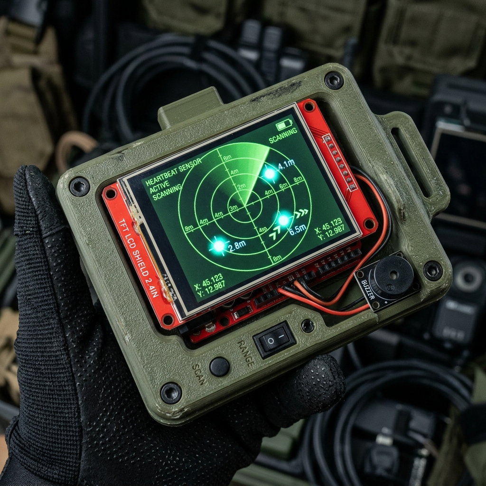
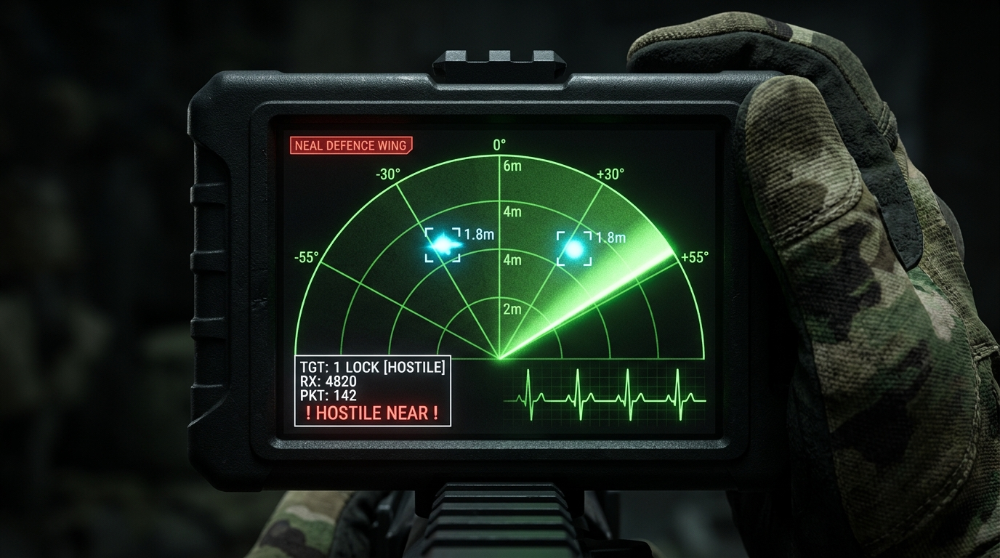
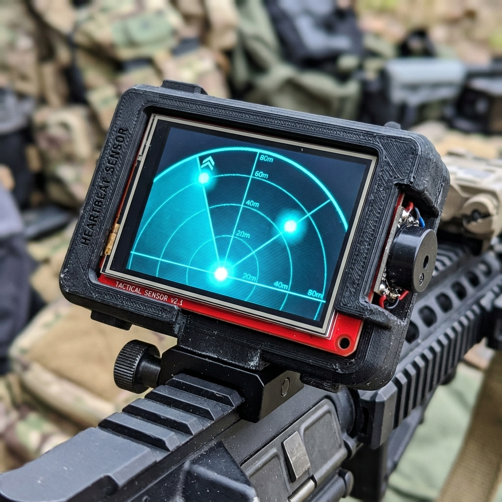
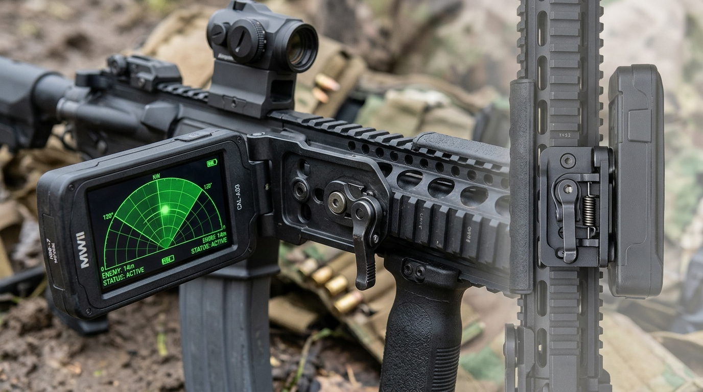

# Project Neal Defence Wing: Tactical Heartbeat Sensor MK-IV

<div align="center">



[-red?style=for-the-badge&logo=github)](https://github.com/mevrickneal)
[](https://github.com/mevrickneal)
[](https://github.com/mevrickneal)
[](https://www.arduino.cc/)
[](https://www.hlktech.net/)

**A battle-ready, weapon-mounted recreation of the iconic Call of Duty: Modern Warfare 2 Heartbeat Sensor.**  
Engineered from the ground up with 24GHz active mmWave FMCW radar, 120° forward sector CRT phosphor sweep, mechanical Geiger-Müller acoustic synthesis, and a 90° flip-to-side tactical rifle mounting bracket.

</div>

---

> [!IMPORTANT]
> **Active Ongoing R&D Project:** This project is under continuous active development by **Lian Mollick** for the **Project Neal Defence Wing**. Future revisions are slated to integrate 60GHz/77GHz industrial MIMO mmWave radar (Texas Instruments IWR6843) and Ultra-Wideband (UWB) through-wall bio-radar sensors.

---

## 📸 Tactical Display Showcase

### 1. Authentic 120° Forward Sector HUD
Mounted on a firearm rail, the operator views a high-contrast 320x240 landscape CRT-style radar display that plots hostiles within a forward $120^\circ$ arc ($\pm 55^\circ$ FOV):



### 2. Close-Combat Acquisition
When hostiles penetrate within close range ($< 2.5\text{m}$), the radar highlights targets with high-threat red brackets, distance telemetry tags, and an urgent HUD threat warning:



### HUD Telemetry Layout:
- **120° Forward Sector Fan Arc:** Radiates upwards from the bottom origin, mapping the forward combat sector.
- **Range Grids:** 2-pixel concentric arcs at **2 meters**, **4 meters**, and **6 meters**.
- **Polar Azimuth Spokes:** Calibrated radial lines at `-55°`, `-30°`, `000°` (bore centerline), `+30°`, and `+55°`.
- **Phosphor Persistence Trail:** 4-stage CRT fade line running at a smooth **~45 FPS** via non-blocking hardware scheduling.
- **Dual-Layer Hostile Blips:** Cyan-blue radar blips with white glowing centers, dynamic lock brackets `[ ● ]`, and live distance tags (e.g. `1.8m`).
- **Telemetry Station (Bottom-Left):**
  - `TGT: [0-3] LOCK [HOSTILE]`
  - `RX: <count>` (Live UART byte throughput counter)
  - `H:0xXX PKT: <count>` (Real-time packet parsing diagnostics)
  - Flashing alarm: `! HOSTILE NEAR !`
- **Dynamic ECG Heartbeat (Bottom-Right):** Real-time electrocardiogram waveform that spikes dynamically as hostile targets approach.

---

## 🔫 Tactical Rifle Mounting & 90° Flip-to-Side (FTS) Mechanism

Engineered to mount directly to the **left-side (9 o'clock) Picatinny (MIL-STD-1913) or M-LOK rail** of an M4A1 carbine handguard, utilizing a spring-loaded **90° flip-to-side locking detent hinge**:



### Dual Operational Configurations:
1. **DEPLOYED (Reconnaissance Mode - 90° Outward):**
   - Unit flips open perpendicular to the rifle handguard.
   - Positioned in the operator's left-eye peripheral vision, sitting completely below and clear of primary red dot / holographic optic sightlines.
   - Radar antenna points directly forward downrange along the rifle's bore axis.
2. **STOWED (Combat / Sprint Mode - 0° Flush):**
   - Quick thumb release folds the entire display flat against the rifle's handguard.
   - Sits flush against the receiver with zero snag points for two-point sling transitions, door breaches, and tactical sprinting.
   - Protects the LCD glass face against weapon impact and debris during intense movement.

---

## 🔊 Authentic Geiger-Müller Acoustic Engine

Standard buzzers produce piercing, annoying continuous square waves. This project implements a **pure mechanical impulse synthesizer**:

- **Sub-Millisecond Diaphragm Snapping (`geigerClick()`):**
  ```cpp
  void geigerClick() {
    digitalWrite(BUZZER_PIN, HIGH);
    delayMicroseconds(500); // 0.5ms mechanical impulse
    digitalWrite(BUZZER_PIN, LOW);
  }
  ```
  Produces a crisp, authentic mechanical "tick/click" by flexing the piezo diaphragm once without tonal ringing.
- **Proximity-Scaled Click Cadence:**
  - **Point-Blank Danger ($< 0.4\text{m}$):** Intense Geiger chatter (**~50 ms – 70 ms** between clicks).
  - **Close Hazard ($1.0\text{m}$):** Rapid tactical alert (**~180 ms**).
  - **Combat Distance ($2.5\text{m}$):** Moderate pacing (**~430 ms**).
  - **Distant Tracking ($5.0\text{m}$):** Slow, calm ticking (**~950 ms**).
- **Stochastic Poisson Jitter ($\pm 15\%$):** Replicates the natural stochastic particle arrival distribution of an authentic Geiger-Müller radiation counter.
- **Silent on Clear:** When no hostile target is detected, the buzzer is completely silent.

---

## ⚡ Hardware Architecture & Wiring

| Subsystem | Hardware Component | Interface & Connections |
| :--- | :--- | :--- |
| **Main Processing Unit** | Arduino Uno R3 (ATmega328P @ 16 MHz) | Master controller running optimized state-machine parser |
| **Radar Front-End** | Hi-Link HLK-LD2450 24GHz FMCW mmWave | **TX** $\rightarrow$ Arduino **Pin 0 (RX)**<br>**RX** $\rightarrow$ Arduino **Pin 1 (TX)**<br>**VCC** $\rightarrow$ **5V** (4.7–5.0V)<br>**GND** $\rightarrow$ **GND** |
| **Tactical Display** | 2.4" / 2.8" TFT LCD Shield (320x240) | Parallel 8-bit bus (MCUFRIEND / ILI9341 driver) |
| **Acoustic Transducer** | 5V Piezo Buzzer | Positive $\rightarrow$ **Pin 10**<br>Negative $\rightarrow$ **GND** |

---

## 🔬 Scientific & Research Foundations

The operating principles of the Project Neal Heartbeat Sensor are grounded in peer-reviewed academic radar research on millimeter-wave continuous-wave FMCW target detection and bio-radar micro-Doppler extraction:

1. **Human Target Tracking & Classification:**
   - **Will, C., Vaishnav, P., Chakraborty, A., & Santra, A.** (2019). *"Human Target Detection, Tracking, and Classification Using 24-GHz FMCW Radar"*, **IEEE Sensors Journal**, 19(17), pp. 7283–7299.  
     DOI: [10.1109/JSEN.2019.2914365](https://doi.org/10.1109/JSEN.2019.2914365)
   - *Validates 24GHz FMCW range-Doppler processing, clutter suppression, and multi-target trajectory estimation for moving human subjects.*

2. **Vital Sign & Heartbeat Tracking via FMCW Radar:**
   - **Wang, G., Muñoz-Ferreras, J.-M., Gu, C., Li, C., & Gómez-García, R.** (2014). *"Application of Linear-Frequency-Modulated Continuous-Wave (LFMCW) Radars for Tracking of Vital Signs"*, **IEEE Transactions on Microwave Theory and Techniques**, 62(6), pp. 1387–1399.  
     DOI: [10.1109/TMTT.2014.2320464](https://doi.org/10.1109/TMTT.2014.2320464)
   - *Demonstrates micro-motion phase demodulation for non-contact human respiration and cardiopulmonary thoracic displacement detection.*

3. **Clutter Rejection & Physiological Detection:**
   - **Liu, J., Li, Y., Li, C., et al.** (2021). *"Accurate Measurement of Human Vital Signs with Linear FMCW Radars under Proximity Stationary Clutters"*, **IEEE Transactions on Biomedical Circuits and Systems**, 15(6), pp. 1205–1215.  
     DOI: [10.1109/TBCAS.2021.3123830](https://doi.org/10.1109/TBCAS.2021.3123830)

4. **Micro-Doppler Theory:**
   - **Chen, V. C.** (2019). *"The Micro-Doppler Effect in Radar"*, Artech House Radar Series.  
     *Theoretical basis for analyzing frequency modulation induced by human torso and limb micro-motions.*

---

## 🚀 Future Roadmap: Next-Gen Sensor Upgrades

Project Neal Defence Wing is actively developing the next evolutionary tiers of this platform:

```
[MK-IV: Current Deployment]
  └─ 24GHz FMCW (HLK-LD2450) + ATmega328P + 320x240 Parallel TFT
        │
        ▼
[MK-V: Industrial 3D mmWave Radar]
  └─ Texas Instruments IWR6843 / AWR1843 (60-64 GHz / 77-81 GHz)
  └─ 3D Elevation Beamforming (120° Azimuth × 30° Elevation)
  └─ Sub-centimeter range resolution + point-cloud clustering
        │
        ▼
[MK-VI: Through-Barrier UWB Bio-Radar]
  └─ Ultra-Wideband (UWB) Impulse Radar (XeThru X4 / Novelda)
  └─ Wall penetration (drywall, brick, foliage)
  └─ True non-contact micro-Doppler heartbeat extraction
        │
        ▼
[Compute & Display Upgrade]
  └─ ESP32-S3 Dual-Core 240MHz (8MB PSRAM) or Teensy 4.1 (600MHz ARM M7)
  └─ High-speed DMA SPI for 60 FPS anti-aliased vector HUD
  └─ Integrated LiPo Battery Management + Auto-Sleep Hinge Sensor
```

---

## 🛠️ Zero-Desoldering Upload Tool

Because Arduino Uno Pin 0 is shared between USB communications and the radar's TX stream, an automated retry loop utility is included to flash updates **without desoldering or unplugging any wires**:

```powershell
# Run the automated flash loop:
.\auto_flash_loop.ps1
```
*When prompted `Listening for Reset...`, give the red Reset button a steady tap (press and release). The script locks onto the Optiboot bootloader in ~5 seconds!*

---

## 📜 Credits & Provenance

- **Lead Systems Engineer:** [Lian Mollick](https://github.com/mevrickneal) (@mevrickneal)
- **Organization:** Project Neal Defence Wing — Tactical Avionics & Guidance
- **Inspiration:** *Call of Duty: Modern Warfare 2* (Task Force 141 Tactical Equipment)
- **Protocol Reference:** Adapted from the open-source LD2450 parser by `cfong2001/EBYTE_E54`.

---
<div align="center">
<sub>Project Neal Defence Wing // Tactical Reconnaissance Division // Classified Hardware Specification</sub>
</div>
